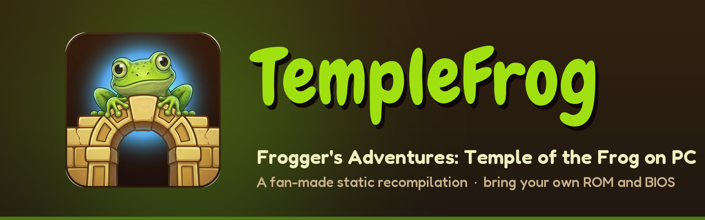
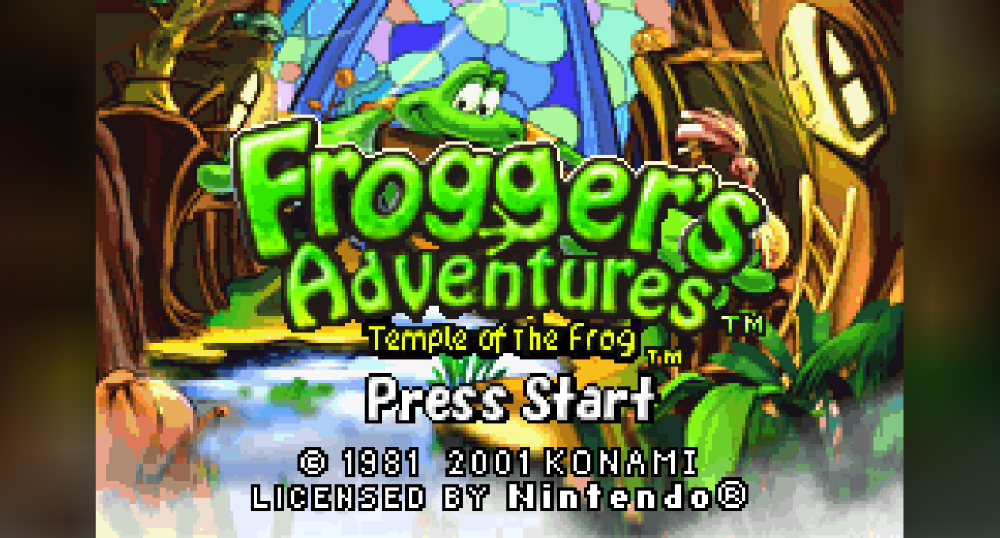
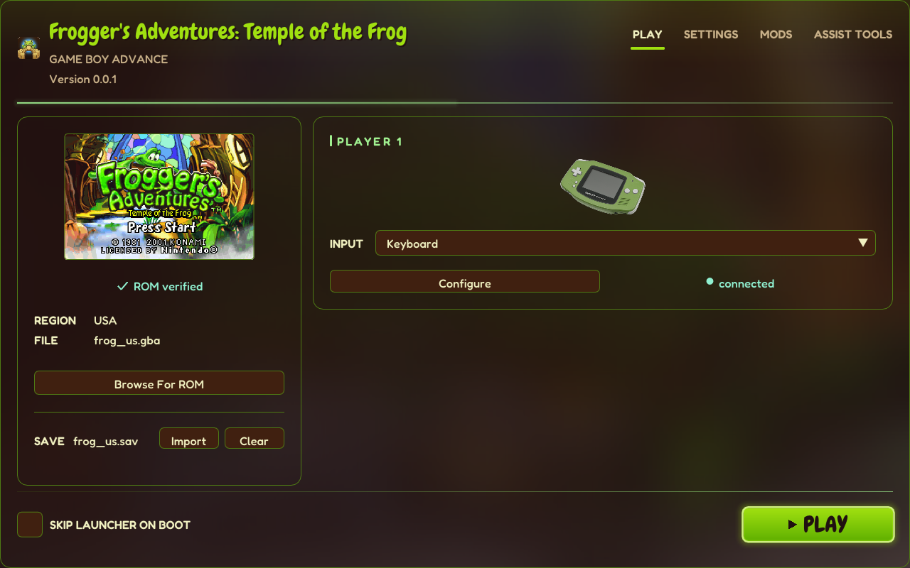
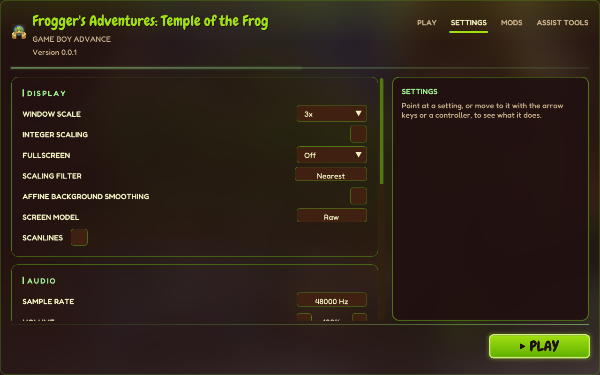
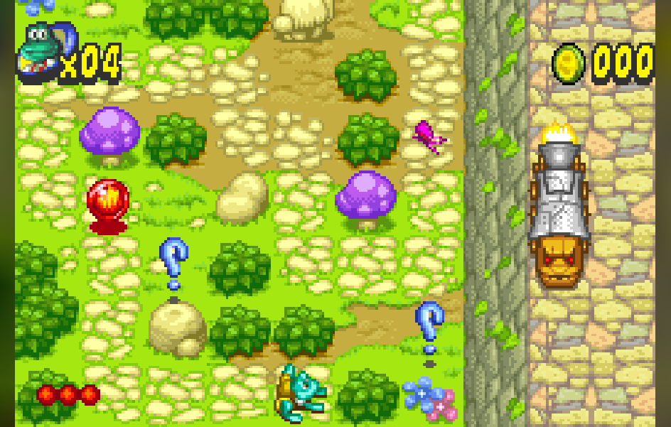
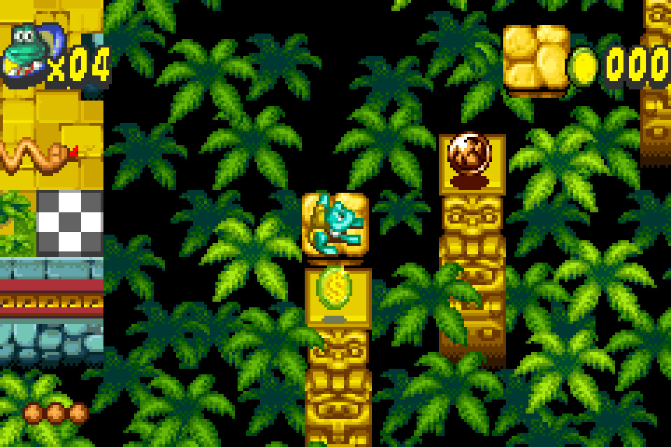
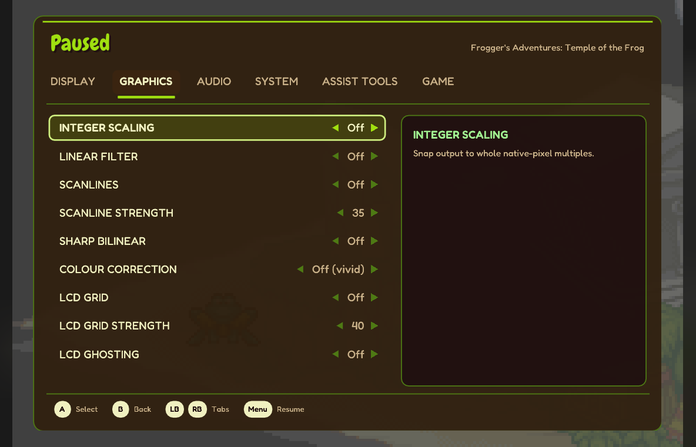
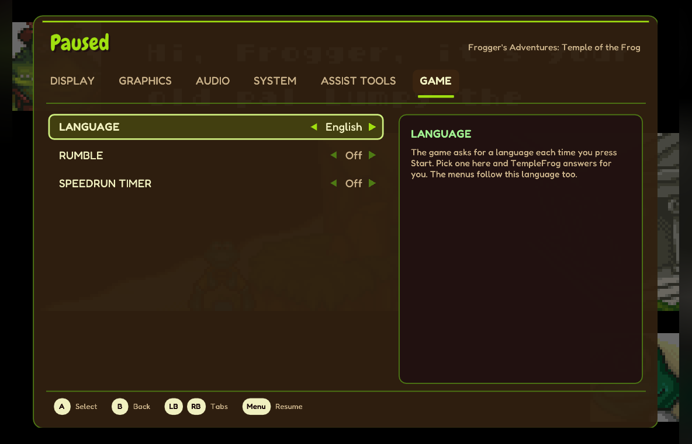
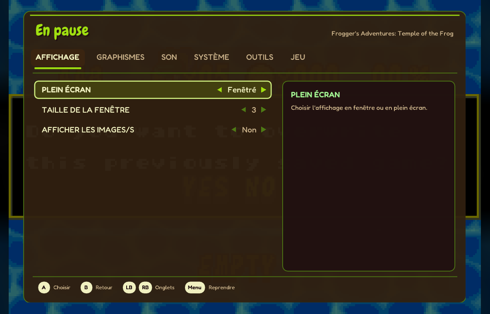
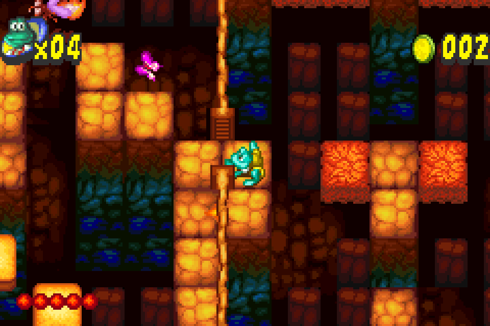

<p align="center"></p>

<p align="center"><a href="https://recomplauncher.com"><picture><source media="(prefers-color-scheme: dark)" srcset="https://recomplauncher.com/assets/press/launcher/badge-light.svg"></picture></a></p>

**TempleFrog** brings *Frogger's Adventures: Temple of the Frog* (Game Boy Advance, 2001) to Windows, Linux and the Steam Deck as a **static recompilation**: the game's code is translated ahead of time into a native PC program with [gbarecomp](https://github.com/mstan/gbarecomp), then dressed up for PC with a launcher, an in-game menu, sharper and cleaner sound, save states, rewind, controller support and the whole interface in the game's five languages. It plays the game itself, exactly as it was, from **your own ROM and BIOS**.

**[⬇ Download TempleFrog](https://devall96.github.io/TempleFrog/)** · [All releases](https://github.com/devall96/TempleFrog/releases) · [Get started](#getting-started) · [What it does](#what-it-does) · [Screenshots](#screenshots)

> [!CAUTION]
> **No game files are included, and none ever will be**: not in the code, the releases, the issues or the wiki. TempleFrog is made to be used with your own, legally obtained copy of the game: you supply the ROM (*Frogger's Adventures: Temple of the Frog*, USA) and a Game Boy Advance BIOS dumped from your own hardware. The box art and backdrop in the launcher are made from your ROM, on your PC. Please don't post ROMs, BIOS files or anything taken from them here.

> [!IMPORTANT]
> **Made with AI.** Every line of TempleFrog's own code, its changes to gbarecomp and recomp-ui, the tests, the art and this page were written or made by Claude, Anthropic's AI, through Claude Code. A human, [devall96](https://github.com/devall96), came up with the idea, directs it and tests every build, but no human reviews the code line by line. [Who did what](#who-did-what) has the details. If you don't want to run code written that way, don't run this. As with anything on the internet, you run it at your own risk.

> [!WARNING]
> **Early: version 0.1, tested on one Windows PC.** The Linux AppImage reaches the title screen in Ubuntu, Debian, Fedora, AlmaLinux and Arch containers but hasn't been played on a real Steam Deck yet. The first level and the attract-mode demos of several worlds have been checked closely (fully static: no interpreted code, no missed functions). Later worlds, the bosses and the Temple haven't been played through on TempleFrog yet. Keep a copy of saves you care about.

> [!NOTE]
> **Not official.** TempleFrog is a fan project. It isn't made by, affiliated with or endorsed by Konami or Nintendo, or by the authors of gbarecomp. Please [open an issue here](https://github.com/devall96/TempleFrog/issues) for TempleFrog problems.

## Screenshots

<p align="center"></p>
<p align="center"><sub>The title in a 16:9 window: the side bars show a soft, blurred glow of the game.</sub></p>

| | |
| --- | --- |
|  |  |
|  |  |
|  |  |
|  |  |

The game graphics in these screenshots come from a legally obtained copy of the game, as they do on your PC. They're © Konami and aren't part of TempleFrog.

## What it does

**The game, faithfully**
- The whole game recompiled to native code ahead of time, with the real GBA BIOS (from your own dump) for the start-up and system calls. No emulator core runs the game.
- Your in-game save works like the cartridge's (EEPROM).

**Sound**
- **Enhanced audio** (on by default): a new high-precision mixer for the game's sound engine. It mixes the music and effects in floating point at your output rate instead of the GBA's 8 kHz, 8-bit mix, with clean resampling, smooth note starts and stops, cleaned-up instrument samples and a look-ahead limiter: no hiss, crunch or clicks. Switch it off for the original sound.
- Output at **48 kHz** by default (Sound > Sample rate in the launcher).

**Picture**
- Window scale, integer scaling, windowed / borderless / exclusive fullscreen.
- Filters: nearest, sharp bilinear, linear, HQ2x / HQ3x / HQ4x, scanlines, LCD grid, LCD ghosting.
- Colour correction: vivid, GBA (unlit or frontlit), GBA SP, classic.
- **Blurred side bars** (or plain black) when the window is wider or taller than the game.

**Convenience**
- **Fast boot**: skips the BIOS logo and the start-up logos, straight to the title in about a second and a half.
- **Save states**, **rewind** (30 s) and **fast-forward** in the in-game menu.
- **Pause when the window loses focus.**
- One `saves` folder for your save and save states, easy to back up or sync.

**Controls**
- Keyboard or any controller, remappable in the launcher; the analog stick works too.
- **Button prompts that match your controller**: Xbox, PlayStation or Switch style, or keyboard keys.
- **Rumble** (optional): when you lose a life, get a 1-up, or pick up an element or a coin.

**Languages**
- The launcher and all menus in **English, French, German, Spanish and Italian**.
- **Game > Language** answers the game's own language screen for you every time you press Start, and the menus follow it. On *Ask every time* they use your Windows language.

**Extras**
- **Speedrun timer**: the level time, total time in levels and the last level's split, counted in game frames.
- **Cheats** (Mods page, off by default): infinite lives.
- **Desktop shortcut** and **Start menu entry** from the launcher.

## Getting started

1. Download **[TempleFrog-0.1.1-windows-x64.zip](https://github.com/devall96/TempleFrog/releases/latest)** and unzip it anywhere you can write to (not *Program Files*).
2. Put your ROM in `roms\frog_us.gba` and your BIOS in `bios\gba_bios.bin`, or start `TempleFrog.exe` and pick them in the launcher (Play → *Browse For ROM*, Settings → *BIOS*).
3. Run **TempleFrog.exe** and press **PLAY**. The first time, TempleFrog builds the game from your ROM and BIOS, which takes a minute or two behind a progress window; after that it starts straight away.

**Why the first start builds the game:** TempleFrog's download holds no code or data from the game. Your own ROM and BIOS are recompiled and compiled on your PC with the game kit that comes with TempleFrog (in the `gamekit` folder: TempleFrog's recompiler and the [Zig](https://ziglang.org) C++ compiler). The result goes in the `native` folder. It is built again only when an update changes the recompiler, or when you pick a different ROM or BIOS.

**On Linux and the Steam Deck:** download **TempleFrog-0.1.1-linux-x86_64.AppImage**, make it executable (`chmod +x`, or *Properties → Permissions* in your file manager) and run it; pick your ROM and BIOS in the launcher. It needs a 64-bit distro with glibc 2.27 or newer (Ubuntu 20.04, Debian 10, Fedora 29, any SteamOS 3 and later) and OpenGL. TempleFrog runs from `~/.local/share/TempleFrog`, where your saves and settings live; an empty `portable.txt` next to the AppImage keeps everything in a `TempleFrog-data` folder beside it instead. On a Steam Deck, add the AppImage to Steam (*Add a Non-Steam Game*) to play it in Game Mode.

**With [RecompLauncher](https://recomplauncher.com)** (Windows, Linux and the Steam Deck): install TempleFrog there and pick your ROM (the .gba, or a .zip with it inside) on its setup screen; it checks the ROM, builds the game from it (once, a minute or two), starts the game straight away and has TempleFrog's settings on the game's page. The BIOS still goes in the `bios` folder as `gba_bios.bin` (next to `TempleFrog.exe`, or in `~/.local/share/TempleFrog` on Linux; the game page's *Game folder* button opens it), or TempleFrog asks for it on the first start. [Quiver Launcher](https://quiverlauncher.com) lists TempleFrog too. Scripts and shortcuts can start straight into the game with `TempleFrog.exe --game <your ROM>` (or `TempleFrog-0.1.1-linux-x86_64.AppImage --game <your ROM>`).

In game, **Esc** opens the menu (on a controller: click a stick, or Select + Start). The launcher checks your files against these:

| File | Version | SHA-1 |
| --- | --- | --- |
| ROM | *Frogger's Adventures - Temple of the Frog* (USA) (En,Fr,De,Es,It), game code `AFRE` | `7b4c27009198df18555e63fb5dcad223eaf09815` |
| BIOS | Game Boy Advance BIOS | `300c20df6731a33952ded8c436f7f186d25d3492` |

Only the USA release is supported in 0.1.

## Your data

- **Nothing is sent anywhere.** No accounts, no telemetry, no update checks, no network use at all.
- Your save and save states are in the `saves` folder next to `TempleFrog.exe`; your settings in `config.ini`, `input.ini` and `templefrog.ini` in the same folder. Delete them to start over.
- The game built from your ROM and BIOS is in the `native` folder, and box art and the launcher backdrop are made once from your ROM into `assets\img`. All of it stays on your PC.

## Building it

TempleFrog builds without a ROM: like the release, it makes the game from the player's ROM at run time (game modules, [`gbarecomp/docs/GAME_MODULES.md`](https://github.com/devall96/gbarecomp/blob/templefrog/presentation/docs/GAME_MODULES.md)). On Windows with [MSYS2](https://www.msys2.org) MINGW64 (`mingw-w64-x86_64-toolchain cmake ninja SDL2`) and Python 3:

```powershell
git clone --recurse-submodules https://github.com/devall96/TempleFrog.git
cd TempleFrog
$env:PATH = "C:\msys64\mingw64\bin;$env:PATH"
python tools\zig_toolchain.py --platform windows --dest tools\toolchain-cache\zig-windows
cmake -S . -B build -G Ninja -DCMAKE_BUILD_TYPE=Release
cmake --build build
build\TempleFrog.exe game.toml
```

`tools\zig_toolchain.py` downloads Zig 0.17.1 from ziglang.org (100 MB), checks its SHA-256 and trims it to what the game kit needs. The build puts the kit in `build\gamekit`; the first start builds the game from your ROM into `build\native`. `TempleFrog.exe --kit-selftest` checks the kit without a ROM.

On Linux (`build-essential cmake ninja-build libsdl2-dev python3`, or your distro's equivalents), the same with `--platform linux --dest tools/toolchain-cache/zig-linux` and `build/TempleFrog game.toml`.

For quick work on the game itself, `-DTEMPLEFROG_GAME_MODULES=OFF` links the code from `generated\` instead: run `tools\regen.ps1` (or `tools/regen.sh`) with your ROM at `roms\frog_us.gba` and your BIOS at `gbarecomp\bios\gba_bios.bin` first. Such a build carries the game and must never be published; the packaging scripts refuse it.

Releases: `tools\package_release.ps1 -Version x.y.z` makes the Windows zip. The Linux AppImage is built by GitHub Actions ([`.github/workflows/linux.yml`](.github/workflows/linux.yml)), or locally with `tools/release_appimage.sh x.y.z`, in an AlmaLinux 8 container with podman (glibc 2.28, so it runs on old systems and every Steam Deck), and checked by `tools/test_appimage_distros.sh` on Ubuntu 20.04/22.04, Debian 11, AlmaLinux 8, Fedora 36/latest and Arch. Every package goes through `tools/audit_package.py`, which refuses ROMs, BIOS files, saves, settings, images made from the ROM, code recompiled from the ROM or BIOS, and personal paths. `tools\perf\run_suite.ps1` is the frame-time suite (1% and 0.1% lows, hitches, stutter). Research notes are in [`docs/`](docs).

## Who did what

- **[devall96](https://github.com/devall96)**: the idea, the direction, every decision, and testing every build.
- **Claude** (Anthropic), through Claude Code: TempleFrog's code, the native audio mixer, the changes to gbarecomp and recomp-ui, the translations, the icon (made with Google Gemini from Claude's prompt) and the documentation.

## Credits

- **[gbarecomp](https://github.com/mstan/gbarecomp)** and **[recomp-ui](https://github.com/mstan/recomp-ui)** by Matthew Stanley: the recompiler, runtime and launcher TempleFrog is built on. TempleFrog's changes to them live in [devall96/gbarecomp](https://github.com/devall96/gbarecomp) and [devall96/recomp-ui](https://github.com/devall96/recomp-ui).
- **[JRickey/frog-adv-temple-decomp](https://github.com/JRickey/frog-adv-temple-decomp)**: the decompilation whose notes on the game's memory, modes and sound engine made the language, rumble, cheat and audio work possible.
- Fonts: [Chewy](https://fonts.google.com/specimen/Chewy) (Apache 2.0) and [Fredoka](https://github.com/hafontia/Fredoka-One) (SIL OFL 1.1).
- Full list and licences: [THIRD_PARTY_NOTICES.md](THIRD_PARTY_NOTICES.md).

*Frogger's Adventures: Temple of the Frog* and *Frogger* are © Konami. Game Boy Advance is a trademark of Nintendo. TempleFrog is not affiliated with Konami or Nintendo.

## License

TempleFrog's own code is [MIT](LICENSE). It's built on gbarecomp, which is under the [PolyForm Noncommercial License 1.0.0](https://polyformproject.org/licenses/noncommercial/1.0.0), so **TempleFrog as a whole, including every release, is for non-commercial use only.**

---

<p align="center"><a href="https://ko-fi.com/devall96"></a></p>
